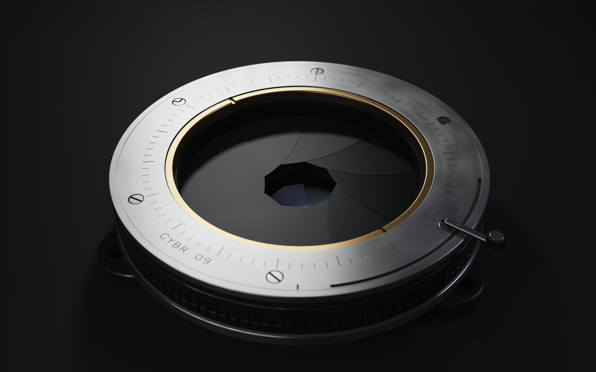
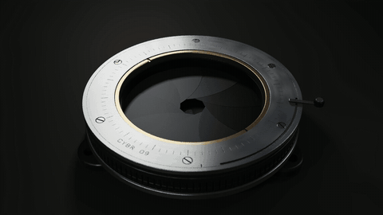

# IRIS / 09

See the [viewer compatibility guide](PORTABILITY.md) for the bounded Live worker, responsive controls, setup and the observed Intel/ANGLE limitation. Film and source downloads remain available when Live cannot run.

The [native still renderer](docs/native-renderer.md) now renders the complete scene directly from the archived equations through OpenGL 3.3. Execution is verified on Windows/WGL and hosted Linux/Mesa and macOS/Mesa software OpenGL. See the [recorded hosted results](docs/native-macos-mesa.md#recorded-hosted-results). It is separate from browser Live, which still has zero verified frames on the audited Intel/ANGLE and macOS SwiftShader configurations.

For actual time, camera and zoom interaction on that computer, run the [localhost native preview](docs/native-preview.md). It displays newly rendered full-scene stills and keeps the newest requested controls. The verified 160 x 90 AA2 requests took 8-12 seconds including process startup and compilation; this is not real-time playback.

A procedural optical-mechanism study in one GLSL fragment pass: nine swept iris leaves, a linked actuator, recessed refractive elements, machined surfaces, and a thin-lens camera.





The image is the supplied 3840 × 2400 still. The GIF is a reduced 480-pixel-wide, 8 fps preview of the included 1920 × 1080, 24 fps, ten-second recovered film. These are rendered project outputs, not mockups.

## Run

Open `IRIS-09-viewer.html` in a modern browser. It contains the shaders, poster, and film, so it does not require a build step, package installation, or external asset downloads.

If your browser restricts local files, serve this directory:

```sh
python3 -m http.server 8000
```

Then open http://localhost:8000/IRIS-09-viewer.html.

The viewer starts in Film mode. Choose Live for the interactive WebGL2 renderer. Live needs WebGL2, Worker/OffscreenCanvas support and a driver that completes this shader. Known stalled configurations show an explicit experimental-attempt warning. Successful film playback and responsive controls do not establish successful Live rendering.

## Controls

- Film / Live switches between the embedded rendered movie and procedural rendering.
- In Live mode, drag to orbit and scroll to zoom.
- Play/Pause, the timeline, and Reset control the live ten-second cycle.
- Resolution and sample controls trade image quality for live-rendering speed.
- Save PNG exports a rendered frame. GLSL downloads the complete source.
- FragCoord opens the compact shader in an external editor only when selected.
- Reduced-motion preferences stop automatic film playback and live animation.

## Files

- `IRIS-09.glsl`: readable Revision 3 source, 43,865 bytes.
- `IRIS-09-fragcoord.glsl`: compact source for FragCoord, 22,533 bytes.
- `IRIS-09-viewer.html`: self-contained browser viewer with embedded media.
- `IRIS-09-recovered.mp4`: recovered ten-second film, 240 frames at 24 fps.
- `media/`: the full-size still and lightweight README animation.

The viewer's embedded readable and compact shaders match the corresponding standalone files byte-for-byte. Its embedded film also matches `IRIS-09-recovered.mp4` byte-for-byte.

## Rendering model and limits

The source builds geometry and materials procedurally. Its lighting includes anisotropic GGX response, finite emitters, filtered machining detail, vector engraving, and refraction. RGB dispersion uses a three-wavelength approximation; indirect light and secondary optical reflections are bounded approximations.

The mechanism is an animated visual study. It has not been established as a manufactured design, hardware qualification, unbiased optical simulation, or engineering-tolerance validation. The source's ten-second aperture, actuator, and camera cycle does not demonstrate mechanical feasibility.

The preserved package includes the browser source and completed film, but not the original offline movie-capture script. The new native renderer produces stills with the original scene, transport and sampling equations; it does not claim to reproduce the recovered movie's capture pipeline. Publication verification and the subsequent execution checks are documented separately in the compatibility and native-renderer guides.

## License and dependencies

No project license was supplied with this source package, and this publication adds no license grant. The browser viewer has no third-party package dependencies or remotely loaded assets. A WebGL2-capable browser is required for Live mode; Python is only an optional local file server.
