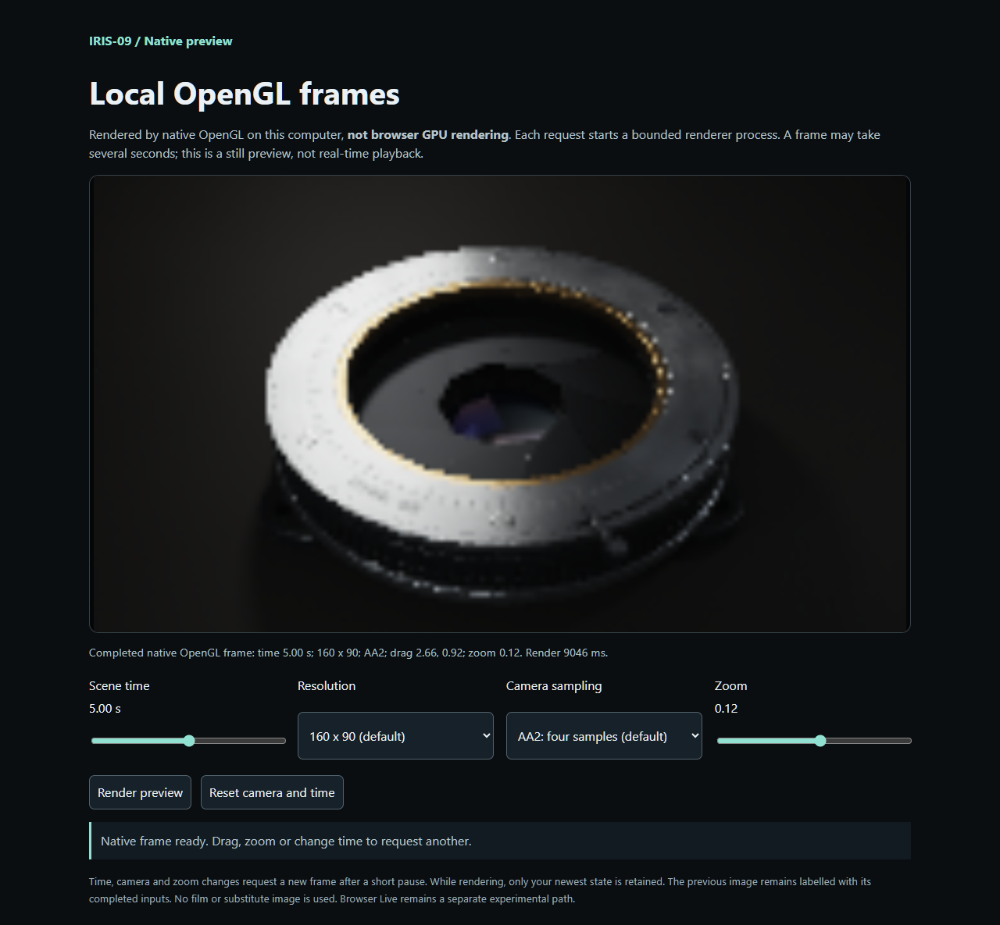

# Local native preview

This separate preview serves new PNG frames rendered by the existing native OpenGL renderer on your computer. It is not browser GPU rendering, video playback, or a realtime guarantee. The archival viewer and renderer equations are unchanged.

From the repository root, using the isolated Python environment described in the [native setup guide](native-renderer.md), with `requirements-native.txt` installed:

```sh
python tools/serve_native.py
```

Open the exact `http://127.0.0.1:PORT` address printed in the terminal. No browser opens automatically. Click **Render preview**, then change time, drag the image, or scroll to zoom. Arrow keys on the focused image and the zoom slider provide keyboard alternatives. Stop the server with Ctrl+C.

The default is the declared **160 x 90, AA2 (four camera samples)**. Resolution and AA1 are explicit user choices; no hidden size or sample reduction occurs. Every request launches a fresh native process, so shader compilation may take several seconds. The most recently requested state wins. Earlier frames keep their completed input labels until a newer frame finishes; failed requests never substitute historical media.

The service binds only `127.0.0.1`, validates its exact Host and same-origin POST requests, and exposes no client-selected path or command. JSON bodies are limited to 4096 bytes. Inputs reject NaN, Infinity, booleans in numeric fields, duplicate/unknown fields, dimensions over 640 or 230400 total pixels, time outside 0-10 seconds, drag outside +/-8192, and scroll outside -2 to 2. Only one render runs at once; concurrent callers receive a busy response without queuing.

Each directly owned native child has a 45-second limit by default (`--timeout` allows 1-120 seconds). Shutdown and timeouts terminate only that child. Already submitted driver work can take time to unwind; this is not a guarantee that a faulty driver can be interrupted. Temporary outputs are owned by the service and removed after each request. Local PNG delivery requires a successful finite completion report and matching dimensions.

`python -m unittest discover -s tests -p test_native_preview.py -v` exercises protocol, bounds and process ownership with mocked renders. Those CPU tests are **not GPU execution evidence**. `python tests/native_preview_smoke.py` separately makes two real HTTP/native requests, checks decoded PNG differences and verifies clean shutdown. It requires the native dependencies and actual OpenGL support.

## Verified Windows preview

Chrome 145 on Windows displayed actual Intel UHD / WGL OpenGL 3.3 frames at 160 x 90 with AA2 (four camera samples). The first request took 12.234 seconds including process startup and compilation. A time-2 request took 8.125 seconds but was superseded and never displayed. The newest request at time 5, with real pointer drag and wheel zoom, took 9.046 seconds and changed 28,070 of 43,200 decoded RGB components. All three native reports confirmed finite completed output at the requested settings.

The completed labels recorded only time 0 and time 5. Controls remained responsive during rendering: the largest measured 50 ms heartbeat gap was 84 ms, and no page errors occurred. A 390 x 844 browser viewport had no horizontal overflow and retained 44-pixel controls. This is layout emulation on the same Windows machine, not a physical mobile GPU test.



The screenshot shows the real time-5 result enlarged from the explicitly selected 160 x 90 resolution; it is not a high-resolution or real-time claim. [The mobile layout screenshot](native-preview-mobile.png) and [sanitized browser receipt](native-preview-verification.json) retain the tested controls, backend, timings and pixel hashes.

The separate [real HTTP smoke receipt](native-preview-http/http-smoke.json) also passed locally: two requests took 11.938 and 10.844 seconds, changed 13,532 of 14,400 decoded pixels, and shut down their owned server and renderer cleanly. Its [first](native-preview-http/first.png) and [changed](native-preview-http/changed.png) images are newly rendered output. All 28 CPU source, viewer and preview contract checks passed; their mocked process tests remain distinct from this GPU evidence.

Linux/macOS native CI is prepared to run the same real HTTP smoke and protocol tests, but has not executed while this work remains local. Browser GPU Live remains separately unresolved; see the [compiler investigation](live-pass-investigation.md).

For actual native execution through HTTP (uses the GPU or configured OpenGL software backend), run `python tests/native_preview_smoke.py`. It saves two fresh PNGs and a sanitized backend/timing report, checks decoded pixel differences at the exact requested states, and verifies server cleanup. This is separate from the mocked CPU tests. The prepared Linux/macOS native CI matrix includes this command; configuration is not a passing run.
