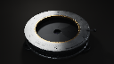
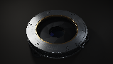

# Native full-scene renderer

This is a new native OpenGL still renderer derived from the preserved `IRIS-09.glsl`. It does not read a movie or substitute a historical frame. It is separate from browser Live and does not establish that WebGL works on the same driver.

The [localhost native preview](native-preview.md) adds browser controls for requesting these actual stills. Its Windows time/drag/zoom flow is verified, with measured 8-12 second requests including startup and compilation.

Create an isolated environment and install its dependencies:

```sh
python -m venv .venv
# Windows PowerShell:
.venv\Scripts\python -m pip install -r requirements-native.txt
.venv\Scripts\python tools/render_native.py --output test-results/native.png --json test-results/native.json
# macOS/Linux:
.venv/bin/python -m pip install -r requirements-native.txt
.venv/bin/python tools/render_native.py --output test-results/native.png --json test-results/native.json
```

The default is an explicitly selected 160 × 90 still, four camera samples (`--samples 2`), and three wavelengths. Set `--width 960 --height 540` to request that resolution, `--time 5 --drag 20 -8 --scroll 1` to change the frame, or `--linear-npy test-results/native-linear.npy` to save top-down linear RGB before vignette and tone mapping. `--samples 1` uses the archival one-sample preview equations, including their different light quadrature. It is never silently selected. Existing output files are rejected rather than overwritten.

The supervisor allows 45 seconds by default; `--timeout` accepts an explicit 1–300 second total limit. A timeout stops only its renderer child. It cannot guarantee immediate cancellation of work already submitted to a graphics driver. Selected resolution is preserved or rejected: six RGBA32F targets are capped at 512 MiB, and the actual device texture-size limit is checked.

The program requests OpenGL 3.3. Windows uses glcontext's default WGL backend, macOS its default CGL backend, and Linux tries EGL then the default window-system backend. The audited Mac CGL software path timed out drawing; use the explicit [Mesa software backend](native-macos-mesa.md) for the verified hosted macOS path. Context creation can still fail when the necessary driver or display service is unavailable. JSON records the selected backend, adapter/version, unsuccessful earlier backend attempts, compilation/render timings, exact camera settings and completion. Hash fields explicitly use normalized text: UTF-8 decoding with universal-newline normalization (CRLF/CR to LF), then UTF-8 re-encoding before SHA256. They are not hashes of raw checkout bytes. A context-selection fallback is not evidence of physical-device coverage; hosted macOS and Linux software-native results are recorded below, without implying physical GPU coverage.

The split evaluates one complete camera ray and full RGB optical transport at a time. It retains all 24 optical iterations and the original RGB weight termination. For each wavelength it accumulates samples in the original x-fast/y-slow order into a float32 target, starting from zero. It selects R/G/B from the corresponding wavelength, divides once by the camera sample count, and applies the original vignette, ACES, gamma and dither. Only the desktop `noise2`/`noise3` function names are namespaced to avoid GLSL built-ins. The source archive is unchanged.

The prototype was compared at 128x72, four camera samples, four time/drag/zoom snapshots and all three wavelengths against frozen original single-wavelength reference programs. Across 331,776 linear RGB values the largest absolute difference was 2.384185791e-7; all values were finite. This is float32 numerical agreement on the audited Windows driver, not bit-exact or cross-device equivalence. The packaged command was subsequently executed on Windows/WGL: AA2 at 128x72 compiled in 5.776 seconds and rendered in 35.75 ms, with selected linear RGB matching that validated prototype bit-for-bit. AA1 at 159x91, time 5, drag (-20, 9), scroll -1 also completed with finite pixels, compiling in 5.445 seconds and rendering in 15.33 ms. These timings describe those small frames and do not establish high-resolution or other-device performance.

For an optional reproducible GPU numerical check, run the following with the same isolated interpreter used for rendering:

```sh
python tools/validate_native.py --json test-results/native-validation.json
```

This has a fixed 60-second child-process deadline. At its default 128x72 size it compares all RGB components from all three wavelengths at four camera snapshots (331,776 values). The independent reference keeps the archival camera AA loops and uses one literal fixed-dispersion call in `shadeRay`; it outputs linear color after the original AA average without defining `CAPTURE`. The candidate uses separate single-sample draws and ordered float accumulation. The command fails unless both outputs are finite and every absolute component error is at most `1e-5`. Its JSON records actual errors, settings, normalized-text shader hashes and driver information. Smaller explicit `--width`/`--height` values are permitted up to 128x72; they reduce coverage and the report records the resulting count. This optional validator is separate from the CPU checks below.

Run the dependency-free source/setup checks with:

```sh
python -m unittest discover -s tests -p test_native_generator.py -v
python -m unittest discover -s tests -p test_native_validator.py -v
python tools/render_native.py --help
python tools/validate_native.py --help
```

No license is added or changed by this renderer.

## Recorded execution evidence

The [packaged numerical validator result](native-validation.json) passed on Windows with Intel UHD Graphics, OpenGL 3.3 driver 31.0.101.4146. It completed in 21.63 seconds; all 331,776 compared RGB values were finite and maximum absolute error was 2.384185791e-7, below its explicit 1e-5 limit. This is a measured comparison against independently generated original whole-AA reference programs, not a shader-source similarity score.

These small images are actual newly rendered command outputs, separate from the historical film:

| Settings | Actual native output |
| --- | --- |
| 128 x 72, AA2, time 0, default camera |  |
| 159 x 91, AA1, time 5, drag (-20, 9), scroll -1 |  |

The browser's default Direct3D-backed compiler still times out on the full optical transport program. The native tool is an available full-scene still-rendering path; it does not claim to repair browser Live or qualify every platform.

## Hosted execution coverage

The `Native IRIS rendering` workflow runs real AA2 and AA1 commands plus the independent original-shader comparison on Ubuntu 24.04 and macOS 15. Linux explicitly selects surfaceless EGL and Mesa software rendering; macOS explicitly selects Homebrew Mesa EGL/llvmpipe after the initial CGL draw failure. Each renderer process is bounded at 60 seconds, as is the numerical validator. Failed context creation, shader compilation, nonfinite output or numerical mismatch fails the job; there is no skip-to-success or prerecorded-frame substitute. PNGs and JSON receipts are retained even when a later step fails.

The [hosted native run at 03d56b3](https://github.com/cybrdelic/cybr-iris09/actions/runs/39866943666) passed on Ubuntu 24.04 and macOS 15 ARM64. The original Mesa adapter run also passed with 331,776 finite comparisons and maximum absolute error 0.0 on both runners; see [recorded hosted results](native-macos-mesa.md#recorded-hosted-results). The Windows native command was executed locally. The separate viewer workflow checks usable browser controls and records any Live failure; neither workflow establishes universal GPU support, physical-phone rendering or real-time performance.
